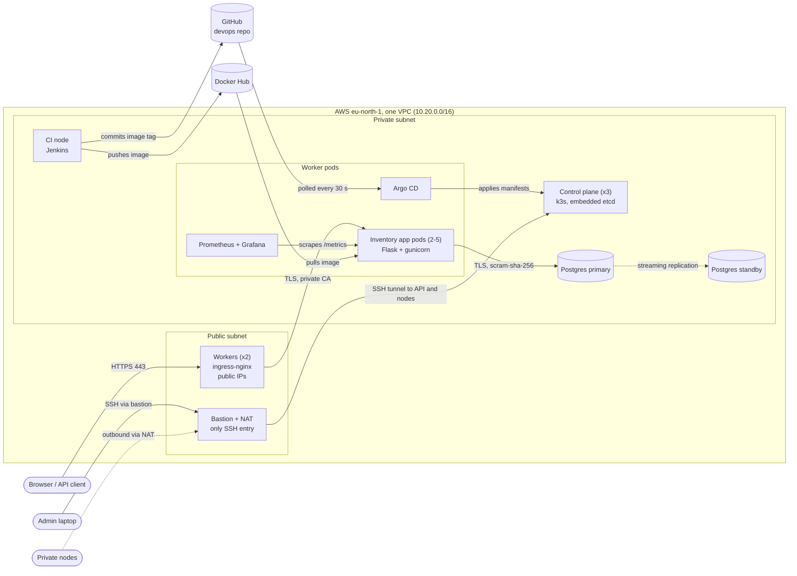

# Architecture

The inventory app runs on a small Kubernetes cluster that we built ourselves on
AWS EC2. Everything is defined in code: Terraform creates the servers, Ansible
configures them, Kubernetes runs the app, Argo CD keeps the cluster equal to
git, and Jenkins tests and builds each change.

**Reading the diagram.** Visitors reach the site only through the two workers,
on ports 80 and 443. ingress-nginx terminates HTTPS with a certificate from our
private certificate authority and passes requests to the app pods. The app
connects to the primary Postgres server over TLS. The standby receives every
change by streaming replication, ready to be promoted by hand. Prometheus
scrapes each app pod, and Grafana draws the dashboards. The admin reaches
everything through the bastion, which is the only machine with a public SSH
port. The bastion is also the NAT box, so private nodes can download packages
and images.

**Delivery.** A change goes through Jenkins on the CI node. Jenkins runs the
secret scan, lint, unit tests, builds the image, scans it for vulnerabilities,
and pushes it to Docker Hub under the commit ID. It then commits the new image
tag to the devops repo. Argo CD notices the commit within 30 seconds and applies
it to the cluster. Jenkins then waits for Argo CD to report the app Healthy and
runs a smoke test over HTTPS. Git is the source of truth: nothing is changed in
the cluster by hand.

**Why it is built this way.** The app runs on Kubernetes so that it can scale
(2 to 5 pods, driven by CPU) and survive a worker failure. Postgres runs outside
the cluster on its own servers, so the database is not affected by pod restarts,
and the standby is a copy that can be promoted. Three control-plane servers keep
the cluster running if one fails. EC2 is the only AWS service we use, which keeps
the cost low and the scope small. The main trade-offs are written up in the
architecture decision records in `docs/adr/`, and the known gaps are listed in
`SECURITY.md`.
